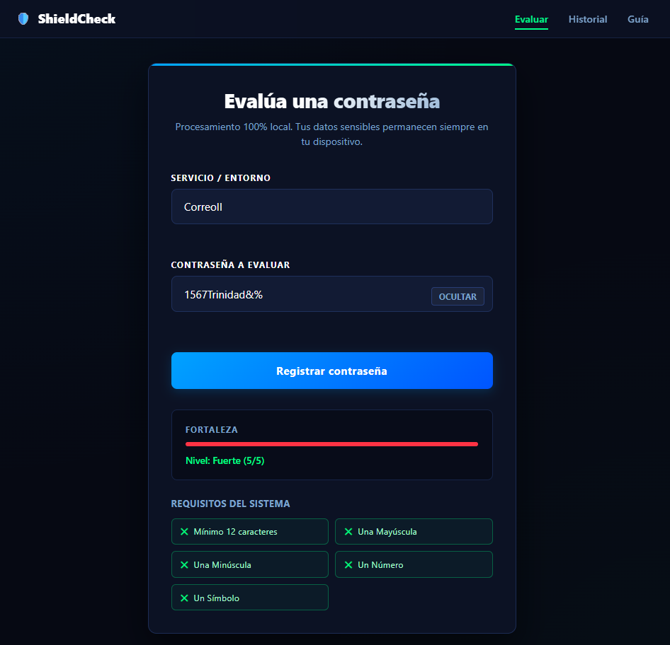
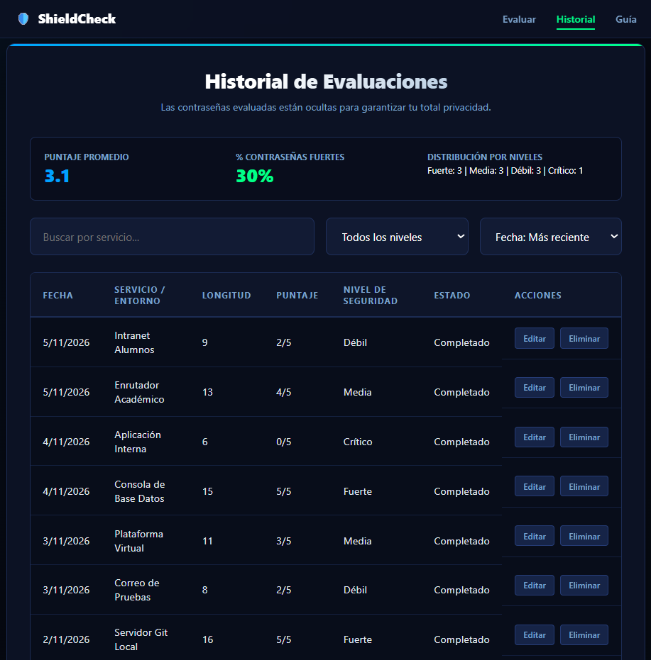
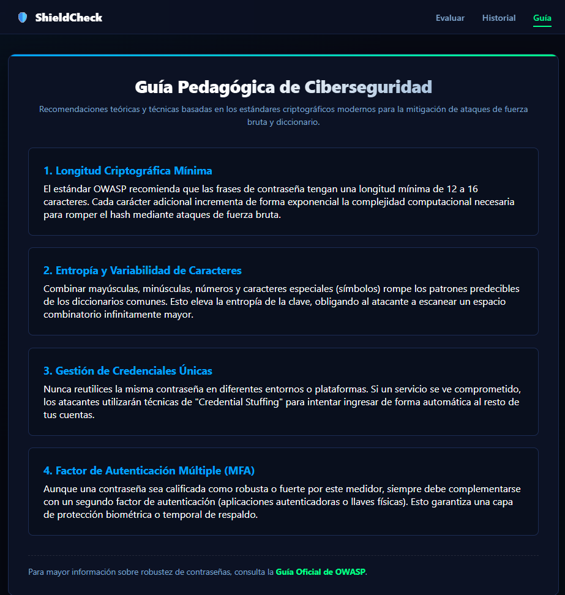

# ProgramacionII_Proyectos
## Evaluador de Contraseñas Educativo (ShieldCheck)
> **Proyecto Académico | Programación II (IC010404)**  
> *Escuela Profesional de Ingeniería en Ciberseguridad — FIIS-UNAS*  
> **Ciclo Académico:** 2026-II

---

## Integrantes (Equipo 2)
*   **Desarrollador 1:** Diaz Fernandez Gabriela Sharith — `SharitheDiaz`
*   **Desarrollador 2:** Meza Riveros Shayury Minerva — `Mezasayuri100-ai`

--- 

## Descripción del Proyecto
Este proyecto consiste en una aplicación web interactiva desarrollada estrictamente bajo estándares de **HTML5 semántico, CSS3 nativo y JavaScript (Vanilla JS)**, sin el uso de librerías ni frameworks externos. 

Su propósito central es puramente educativo: evalúa la robustez de contraseñas de forma local en el navegador, educa al usuario sobre criterios de complejidad criptográfica y registra métricas de auditoría en un historial de evaluaciones.

### Enfoque de Ciberseguridad Específica
Alineado con las directrices del proyecto y el estándar de seguridad OWASP:
1. **Principio de Privacidad:** Las contraseñas ingresadas **NUNCA** se guardan en el almacenamiento local (`localStorage`), ni se envían a ningún servidor externo.
2. **Mitigación XSS:** Toda inyección o renderizado de datos dinámicos se procesará mediante `textContent`, aunlando la ejecución de scripts maliciosos (`innerHTML` deshabilitado por completo).
3. **Persistencia Segura:** Solo se almacena el metadato del análisis (Fecha, Servicio, Longitud, Puntaje y Nivel de Seguridad).

---

## 🚀 Estado de Entregas y Control de Etapas

A continuación se detalla la matriz de progreso del desarrollo dividido en las fases obligatorias del ciclo de vida del proyecto:

| **Etapa** | **Versión** | **Componentes y Entregables** | **Estado** | **Evidencia de Código** |
| :--- | :---: | :--- | :---: | :--- |
| **E1: Estructura y Navegación** | `v0.1` | Maquetación base con HTML semántico. Formulario seguro estructurado, tabla de historial y sección pedagógica. | 🟢 Completado | [Ver Rama](https://github.com) |
| **E2: Diseño Responsive** | `v0.2` | Mobile-first con Flexbox/Grid y variables CSS. Centrado estricto de paneles y soporte para 3 anchos de pantalla. | 🟢 Completado | [Ver Rama](https://github.com) |
| **E3: Registro y Presentación** | `v0.3` | Lógica JS para persistencia JSON en localStorage. Buscador y filtros algorítmicos integrados. | 🟢 Completado | [Ver Rama](https://github.com) |
| **E4: Interfaz y Usabilidad** | `v0.4` | Validación accesible en tiempo real. Gestión de estados de foco/error y cumplimiento de 5 heurísticas de Nielsen. | 🟢 Completado | [Ver Rama](https://github.com) |
| **E5: Integración y Entrega** | `v1.0` | Despliegue productivo, documentación de pruebas de aceptación y análisis de seguridad definitivo. | 🟢 Completado | [Ver Rama](https://github.com) |

---

## Despliegue de la Aplicación
El sitio web se encuentra publicado a través de la infraestructura de alojamiento estático de GitHub:
https://sharithediaz.github.io/ProgramacionII_Proyectos/
---

## 🛠️ Arquitectura y Estructura del Repositorio
El código fuente está estructurado de manera modular para separar la capa de presentación de la lógica de acceso a datos:

```text
├── index.html              # Interfaz de Evaluación de Contraseñas (Página Principal centralizada)
├── historial.html          # Panel de Auditoría y Métricas (Tabla de Registros con Filtros)
├── guia.html               # Módulo Pedagógico y Recomendaciones de Seguridad (Tarjetas de Élite)
├── README.md               # Documentación Técnica del Proyecto (Este Archivo)
├── css/
│   └── estilos.css         # Hojas de Estilo CSS3 Nativo (Variables, Modo Oscuro y Media Queries)
├── js/
│   ├── app.js              # Controlador de Interfaz, Interacción del Menú y Motor de Evaluación
│   └── datos.js            # Modelo de Capa de Datos (Serialización Segura y Persistencia Local)
└── docs/
    └── investigacion/      # Repositorio de Fichas de Investigación Autónoma (S11-S15)
```

---
## 📷 Capturas de Pantalla (Evidencia de Funcionamiento)

### 1. Vista del Módulo "Evaluar" (`index.html`)


### 2. Vista del Módulo "Historial" (`historial.html`)


### 3. Vista del Módulo "Guía Educativa" (`guia.html`)
